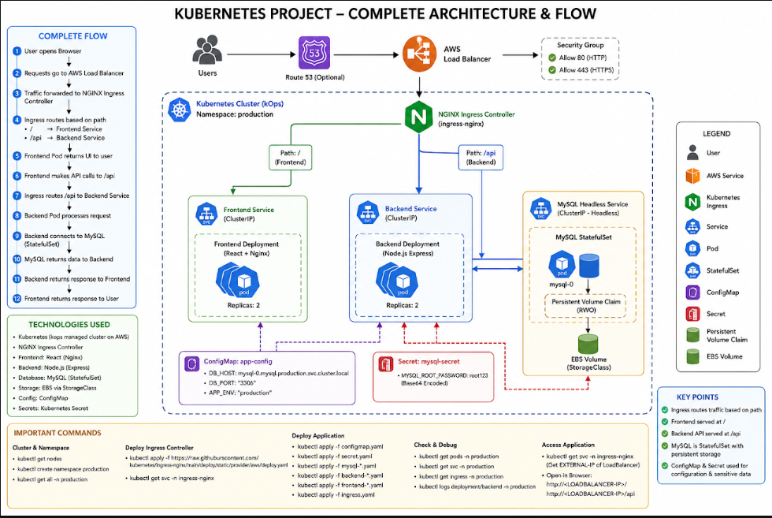

# 🚀 Kubernetes Three-Tier Application on AWS (kOps)

A production-style **three-tier application** deployed on **Kubernetes (kOps on AWS)** using an **Nginx frontend**, **Node.js backend** and **MySQL StatefulSet** with persistent EBS storage. Traffic is routed through an **NGINX Ingress Controller** behind an **AWS Load Balancer**.


---

## 📑 Table of Contents

1. [Architecture](#-architecture)
2. [Features](#-features)
3. [Tech Stack](#-tech-stack)
4. [Project Structure](#-project-structure)
5. [Prerequisites](#-prerequisites)
6. [Quick Start](#-quick-start)
7. [Manual Deployment](#-manual-deployment)
8. [Verify & Access the Application](#-verify--access-the-application)
9. [Test Data Persistence](#-test-data-persistence)
10. [Zero-Downtime Update](#-zero-downtime-update)
11. [Useful Commands](#-useful-commands)
12. [Troubleshooting](#-troubleshooting)
13. [Security Notes](#-security-notes)
14. [Practice Tasks](#-practice-tasks)
15. [Cleanup](#-cleanup)
16. [License](#-license)

---

## 🏗 Architecture



```
User → (Route 53) → AWS Load Balancer → NGINX Ingress Controller
                                          ├─ /     → frontend-service → Frontend Pods (x2, Nginx)
                                          └─ /api  → backend-service  → Backend Pods (x2, Node.js)
                                                                              ↓
                                                        mysql (headless) → MySQL StatefulSet (mysql-0)
                                                                              ↓
                                                                        PVC → PV (EBS)
```

### Request Flow

1. User opens the browser
2. Request goes to the AWS Load Balancer
3. Traffic is forwarded to the NGINX Ingress Controller
4. Ingress routes by path: `/` → Frontend, `/api` → Backend
5. Frontend pod returns the UI
6. Frontend calls the `/api` endpoint
7. Backend pod processes the request
8. Backend connects to MySQL (StatefulSet)
9. MySQL returns data to the Backend
10. Backend returns the response to the Frontend
11. Frontend displays the result to the user

---

## ✨ Features

- Three-tier architecture (Frontend, Backend, Database)
- Path-based routing using NGINX Ingress
- MySQL as a **StatefulSet** with persistent storage (PVC/PV on EBS)
- Configuration via **ConfigMap**, credentials via **Secret**
- 2 replicas each for frontend and backend (high availability)
- Readiness probes for backend and MySQL
- Auto-seeded database on first startup
- Rolling updates with zero downtime

---

## 🛠 Tech Stack

| Layer          | Technology                              |
|----------------|-----------------------------------------|
| Cloud          | AWS (EC2, EBS, ELB, Route 53)           |
| Orchestration  | Kubernetes (kOps managed cluster)       |
| Ingress        | NGINX Ingress Controller                |
| Frontend       | HTML + Nginx (can be upgraded to React) |
| Backend        | Node.js + Express                       |
| Database       | MySQL 8.0 (StatefulSet)                 |
| Storage        | EBS via StorageClass (PVC/PV)           |
| Containers     | Docker / DockerHub                      |
| Config/Secrets | ConfigMap, Secret                       |

---

## 📁 Project Structure

```
.
├── frontend/
│   ├── Dockerfile
│   └── index.html
├── backend/
│   ├── Dockerfile
│   ├── server.js
│   └── package.json
├── k8s/
│   ├── namespace.yml
│   ├── configmap.yml
│   ├── secret.yml
│   ├── mysql-init-configmap.yml
│   ├── mysql-headless.yml
│   ├── mysql-statefulset.yml
│   ├── backend-deployment.yml
│   ├── backend-service.yml
│   ├── frontend-deployment.yml
│   ├── frontend-service.yml
│   └── ingress.yml
├── scripts/
│   ├── build-push.sh
│   ├── deploy.sh
│   └── cleanup.sh
├── docs/
│   ├── architecture.png
│   └── react-frontend.md
├── .env.example
├── .gitignore
├── LICENSE
└── README.md
```

---

## ✅ Prerequisites

- A running Kubernetes cluster on AWS (kOps) with `kubectl` configured
- Docker installed
- A DockerHub account
- A default StorageClass (EBS) available

```bash
kubectl get nodes
kubectl get sc
docker --version
```

---

## ⚡ Quick Start

```bash
# 1. Clone the repository
git clone https://github.com/<your-username>/<repo-name>.git
cd <repo-name>

# 2. Build and push Docker images
./scripts/build-push.sh <dockerhub-username> v1

# 3. Update image names in:
#    k8s/backend-deployment.yml
#    k8s/frontend-deployment.yml

# 4. Deploy everything
./scripts/deploy.sh

# 5. Get the Load Balancer address
kubectl get svc -n ingress-nginx
```

---

## 🔧 Manual Deployment

### Step 1: Build and push images

```bash
cd backend
docker build -t <dockerhub-username>/backend:v1 .
docker push <dockerhub-username>/backend:v1

cd ../frontend
docker build -t <dockerhub-username>/frontend:v1 .
docker push <dockerhub-username>/frontend:v1
```

### Step 2: Deploy to Kubernetes

```bash
# Namespace, config and secrets
kubectl apply -f k8s/namespace.yml
kubectl apply -f k8s/configmap.yml
kubectl apply -f k8s/secret.yml

# Database
kubectl apply -f k8s/mysql-init-configmap.yml
kubectl apply -f k8s/mysql-headless.yml
kubectl apply -f k8s/mysql-statefulset.yml

# Backend
kubectl apply -f k8s/backend-deployment.yml
kubectl apply -f k8s/backend-service.yml

# Frontend
kubectl apply -f k8s/frontend-deployment.yml
kubectl apply -f k8s/frontend-service.yml

# Ingress controller
kubectl apply -f https://raw.githubusercontent.com/kubernetes/ingress-nginx/main/deploy/static/provider/cloud/deploy.yaml

# Ingress rules
kubectl apply -f k8s/ingress.yml
```

---

## 🌐 Verify & Access the Application

```bash
kubectl get pods -n production
kubectl get svc -n ingress-nginx
kubectl get ingress -n production
```

Copy the `EXTERNAL-IP` (Load Balancer DNS) and open it in your browser:

| URL                                     | Description  |
|-----------------------------------------|--------------|
| `http://<LOADBALANCER-DNS>/`            | Frontend     |
| `http://<LOADBALANCER-DNS>/api/employees` | Backend API |
| `http://<LOADBALANCER-DNS>/api/health`  | Health check |

---

## 💾 Test Data Persistence

```bash
# Delete the MySQL pod
kubectl delete pod mysql-0 -n production

# Watch it come back with the same name and same PVC
kubectl get pods -n production -w
```

Refresh the application. The data is still there because the StatefulSet reattaches the same PVC.

Add more rows manually:

```bash
kubectl exec -it mysql-0 -n production -- mysql -uroot -p
```

```sql
USE company;
INSERT INTO employees(name) VALUES ('Pettri'),('Rakesh');
```

---

## 🔄 Zero-Downtime Update

```bash
# Build and push the new version
docker build -t <dockerhub-username>/frontend:v2 ./frontend
docker push <dockerhub-username>/frontend:v2

# Rolling update
kubectl set image deployment/frontend frontend=<dockerhub-username>/frontend:v2 -n production
kubectl rollout status deployment/frontend -n production

# Rollback if needed
kubectl rollout undo deployment/frontend -n production
```

---

## 📌 Useful Commands

```bash
# Cluster
kubectl get nodes
kubectl get all -n production

# Storage
kubectl get pvc -n production
kubectl get pv

# Logs
kubectl logs deployment/backend -n production
kubectl logs deployment/frontend -n production

# Config and Secrets
kubectl get configmap -n production
kubectl get secret mysql-secret -n production -o jsonpath="{.data.MYSQL_ROOT_PASSWORD}" | base64 -d

# Debug
kubectl describe pod <pod-name> -n production
kubectl exec -it mysql-0 -n production -- bash
```

---

## 🧰 Troubleshooting

| Problem                          | Check / Fix                                                                 |
|----------------------------------|-----------------------------------------------------------------------------|
| Pods in `ImagePullBackOff`       | Check image names in deployment files and that images are pushed            |
| Backend `CrashLoopBackOff`       | `kubectl logs deployment/backend -n production` (usually DB not ready)      |
| `Unable to load employees`       | Check `/api/employees`, backend logs and MySQL pod status                   |
| PVC stuck in `Pending`           | Run `kubectl get sc` and make sure a default StorageClass exists            |
| No `EXTERNAL-IP` on ingress      | Wait a few minutes, then `kubectl get svc -n ingress-nginx`                 |
| Ingress returns 404              | Confirm `ingressClassName: nginx` and `kubectl get ingress -n production`   |

---

## 🔐 Security Notes

- `k8s/secret.yml` has a **demo password** (`root123`). Replace it before real use:
  ```bash
  echo -n 'YourStrongPassword' | base64
  ```
- Do not commit real secrets to a public repository.
- The backend connects as `root` for simplicity. Create a dedicated DB user for production.
- Restrict Security Group rules to ports 80 and 443 only.

---

## 🎯 Practice Tasks

- [x] Move the backend DB password from plain text to a Kubernetes Secret
- [ ] Change the frontend from HTML to **React** (see `docs/react-frontend.md`)
- [ ] Restyle `index.html`, push `v2` and deploy with zero downtime
- [ ] Set up MySQL replication and scale replicas to 2
- [ ] Add HTTPS using cert-manager and Route 53
- [ ] Add resource requests/limits and a Horizontal Pod Autoscaler

---

## 🧹 Cleanup

```bash
./scripts/cleanup.sh

# Remove the ingress controller too
kubectl delete namespace ingress-nginx
```

---

## 📄 License

This project is licensed under the [MIT License](LICENSE).

---

⭐ If you found this project useful, please give it a star!
